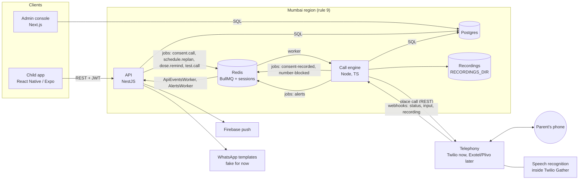
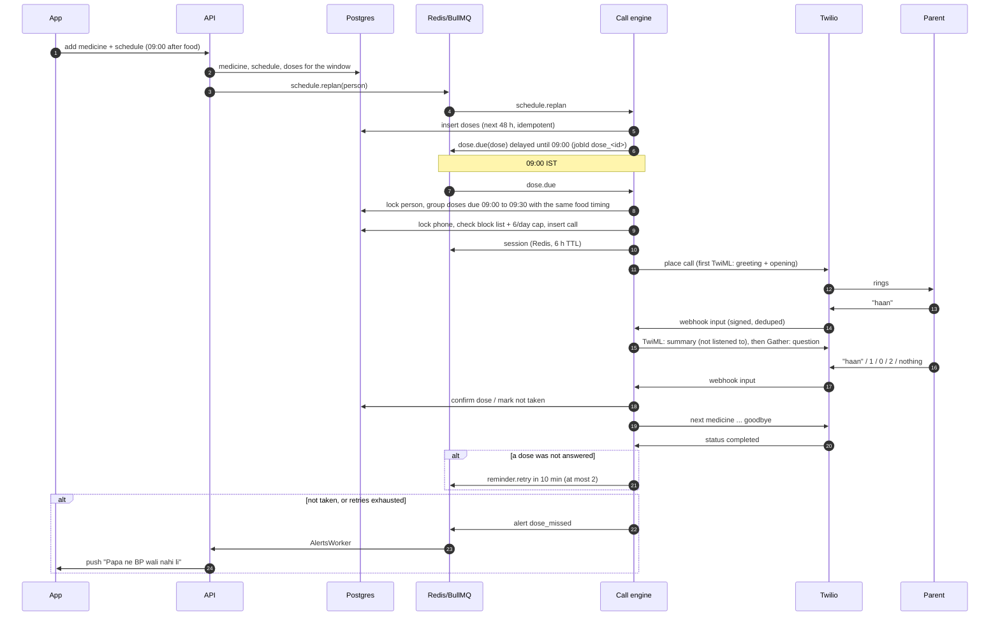

# Tasalli architecture: HLD, LLD, scale and known risks

Status: 24 Nov 2026, after PRs #100 to #105. Owner: lead. Read with `CLAUDE.md` and `docs/handover.md`.

Numbers marked *estimate* come from the code and the test calls, not from load tests (there are none yet).

---

## 1. High-level design

### 1.1 What the system does

A family member (the "child") sets up medicine reminders in an Android app. At each dose time, Tasalli phones the parent, reads out the medicines in Hindi, and records "taken", "not taken" or "no answer". The family gets a push alert when a dose is missed, and a summary every evening.

### 1.2 Components

| Component | Path | Responsibility |
| --- | --- | --- |
| Child app | `apps/mobile` | Sign-in (OTP), add parent, medicines and schedules, see doses, mark as taken |
| API | `services/api` | Accounts, people and consent, medicines, schedules, doses, billing (fake), audit log. Runs 3 workers: API events, dose-window maintenance, **alerts** |
| Call engine | `services/call-engine` | Dose planning, grouping, call placing, call flows, webhooks, retries, caps, recordings |
| Contracts | `packages/contracts` | OpenAPI, `schema.sql`, telephony and speech interfaces, rules (caps, retries, windows) |
| Scripts | `packages/scripts` | Call wording per language (YAML, generated into `engine/*.yaml`) |
| Integrations | `packages/integrations` | OTP, push (FCM), WhatsApp (fake), billing (fake), alert worker |
| Admin console | `apps/admin` | Families, consent and call logs, block list, pause, metrics. Reads Postgres directly |

### 1.3 Queues (BullMQ on Redis, prefix `bull`)

| Queue | Producer | Consumer | Jobs |
| --- | --- | --- | --- |
| `call-engine` | API, call engine itself | call engine (concurrency 20) | `schedule.plan_all` (hourly), `schedule.replan`, `dose.due`, `reminder.retry`, `reminder.snooze` (legacy only), `consent.call`, `consent.retry`, `dose.remind`, `summary.evening`, `recording.fetch`, `test.call` |
| `tasalli-api-events` | call engine | API `ApiEventsWorker` | `consent-recorded`, `number-blocked` |
| `tasalli-api-maintenance` | API | API | `extend-dose-window` |
| `integrations-alerts` | call engine | API `AlertsWorker` (since #105) | `dose_missed`, `evening_summary`, `opted_out`, `plan_lapsed`, and similar |

### 1.4 The life of one dose

---

## 2. Low-level design

### 2.1 Data model (Postgres, `packages/contracts/schema.sql`)

| Table | Key columns | Notes |
| --- | --- | --- |
| `users` | phone (unique), name, locale, time_zone | The account holder (child) |
| `people` | owner_user_id, nickname, **full_name** (required by the API since #101), phone, language, time_zone, can_read_strip, consent, paused, caller_relation | The parent. Max 4 per account (rule 5) |
| `blocked_numbers` | phone | Key 9 / stop phrase. Applies across all accounts (rule 3) |
| `consent_events` | person, result, via, call | Audit of consent |
| `medicines` | person, kind, strip_name, strength_text, spoken_name, appearance (colour, shape, **size: very_small/small/large**, marking, kept_in, pack/print/cap colour), number_label, say_printed_name, active, created_at, updated_at | Look fields required by kind (#101) |
| `schedules` | medicine, local_time (parent's zone, rule 7), amount_text (verbatim, rule 1), food, days_of_week, start/end date | |
| `doses` | schedule, person, due_at (UTC), status, call_group_id, confirmed_at/via | **unique (schedule_id, due_at)**: both dose generators are idempotent |
| `calls` | person, purpose, call_group_id, attempt, provider_call_id (unique), status, result, started/ended_at | `attempt = cycle*3 + n` |
| `webhook_events` | (provider, event_id) | Exactly-once webhooks (rule 6) |
| `devices` | user, push_token (unique) | FCM tokens |
| `subscriptions`, `audit_log`, `support_notes` | | Billing (fake), audit, admin notes |

### 2.2 Dose planning (call engine `engine/scheduler.ts`)

- **Two generators, one table.** The API's `DoseGenerator` (on change and on a maintenance schedule) and the engine's `planPerson` (on `schedule.replan` and hourly `plan_all`) both insert doses with `on conflict (schedule_id, due_at) do nothing`.
- `planPerson`: if the person isn't schedulable (consent, paused, deleted, blocked), nothing is planned. If paused, upcoming doses become `skipped_paused`. Otherwise it plans 48 hours of occurrences in the parent's zone (`occurrences()`, luxon; in a daylight-saving gap the time moves forward), then queues `dose.due` delayed to each due time with `jobId dose_<id>` (so a duplicate enqueue is ignored), plus `summary.evening` at 20:00 local.
- `plan_all` runs every hour and fans out one `schedule.replan` per schedulable person (`jobId replan_<person>_<30-min bucket>`).

### 2.3 Grouping and placing (`doseDue`, `placeReminder`, `place`)

1. Skip if the dose is already grouped, confirmed or closed, or the person isn't schedulable.
2. **Too late:** if more than 30 minutes have passed since the due time (engine was down or backlogged), the dose is marked `missed` and the family is alerted (`too_late`).
3. **One call at a time per person:** if a reminder call is live (not ended, started under 15 minutes ago), retry `dose.due` in 2 minutes.
4. Inside a transaction with the person locked: take all `upcoming` doses due within the next 30 minutes **with the same food timing** whose schedule still matches (`stillMatches`; an edited or deleted schedule is not spoken), and assign them a `call_group_id`.
5. `placeReminder`: re-check consent, pause, block list and billing (`ownerEntitled`), build the script (`buildReminderSteps`), and decide which medicines are described (`describeMedicineIds`) and which are new (`newMedicineIds`).
6. `place`: inside a transaction with the **phone** locked: block list, then the **6 calls per number per local day** cap (rule 5), then insert the `calls` row. Store the session in Redis, then call the provider. On provider error the call is marked failed and `afterNoConfirmation` retries.

### 2.4 Call flow (`engine/flows.ts`, script `packages/scripts/hi.yaml`)

State is kept per call in Redis (`CallSession`): presence state, the medicine index, outcomes per dose, the replay and repeat counters, and the reply already sent per webhook event id (so a duplicate webhook gets the same reply).

```mermaid
stateDiagram-v2
  [*] --> Opening: greeting + "Hum Tasalli app se..." + haan/1?
  Opening --> Opening: unclear/silence (once)
  Opening --> Hangup: still nothing (dose retried in 10 min)
  Opening --> Medicine: haan / any key except 9
  Opening --> OptOut: 9 / stop phrase
  state Medicine {
    [*] --> Summary
    Summary --> Question: spoken outside Gather (not listened to)
    Question --> Taken: haan / 1 (exact yes; Twilio confidence 0.0 accepted only for an exact yes)
    Question --> Summary: phir se / 0 (with description, max 2)
    Question --> NotTaken: nahi / 2 / baad mein
    Question --> Replay: no answer or unclear (first time)
    Replay --> Question
    Question --> LeftOpen: no answer or unclear (second time)
  }
  Medicine --> Medicine: next medicine
  Medicine --> Goodbye: last medicine or the 180 s soft limit
  Goodbye --> [*]
```

- **TwiML (Twilio adapter):** text before the last `LONG_PAUSE` mark is said *before* `<Gather>`, and the question is inside `<Gather bargeIn="false" speechTimeout="1">`. The voice is Google Chirp3-HD (Hindi) via SSML: 90% rate, 200/350/700 ms breaks. The recogniser is set by `TWILIO_SPEECH_MODEL` (`deepgram_nova-2` tested best).
- **Rules in the flow:** a negative wins over a positive (rule 4: "nahi" is matched before "haan"). Unclear speech or silence never confirms. Key 9 blocks the number across every account (rule 3).
- **End of call:** `not taken` closes the dose as `missed` and sends one `said_not_taken` alert. `left open` doses get the 10-minute retries.

### 2.5 Retries, time limits, idempotency

| Rule | Value | Where |
| --- | --- | --- |
| Retries for unanswered doses | 2, 10 min apart, then `missed` + alert `retries_exhausted` | `afterNoConfirmation` |
| Calls per phone per local day | 6, across all accounts | `place()` with the phone lock |
| Grouping window | 30 min, same food timing | `doseDue` |
| Too late | over 30 min after the due time | `doseDue` |
| Soft call limit | 180 s for up to 5 medicines, +40 s each above | `flows.ts` |
| Hard call limit | soft + 30 s (Twilio `TimeLimit`) | `place()` |
| Webhooks | signature check, then `webhook_events` dedupe, then a per-call in-process mutex | `engine.ts` |
| Jobs | deterministic `jobId`s, 3 attempts with exponential backoff, completed jobs kept 7 days | `queue/bullmq.ts` |

### 2.6 Alerts (API `AlertsWorker`, `packages/integrations/src/alerts`)

Jobs carry ids only, and names and statuses are read at send time (`PgAlertData`). So a dose marked taken in the meantime is not reported, and deleted people or accounts get nothing (rule 9). Each channel is claimed in a Redis idempotency store (`<jobId>:push:<user>`), so a retried job does not send twice. Channels: FCM push now, WhatsApp later (opt-in column not built yet).

---

## 3. How far does it scale?

*Estimate.* The assumed workload is 2 to 3 dose times per parent per day (about 3.3 calls per parent per day with retries), with most doses set to round times (08:00, 09:00, 13:00, 20:00, 21:00) in **one time zone** (IST).

| Stage | Parents | First limit hit | What to do |
| --- | --- | --- | --- |
| Today | up to about **1,000 to 1,500** | **Telephony calls per second (CPS).** A Twilio account starts at 1 CPS, so 1,500 calls due at 09:00 take 25 minutes just to dial. Past 30 minutes the engine marks doses `too_late` and alerts families falsely. Concurrent channels on the Exotel or Twilio plan are the other cap. | Buy CPS/channels; spread dials (see 4.1); make "too late" depend on queue time, not wall time |
| Next | about **10,000 to 20,000** | **Redis memory:** about 6 delayed `dose.due` jobs per parent, plus `schedule.replan` every hour per parent kept for 7 days after completion. That's about 2.4 million job records at 10k parents. Also the **single call-engine process**: the webhook lock is in memory, so a second instance is unsafe. | Keep completed jobs for minutes, not 7 days, for high-volume jobs. Replace the hourly fan-out with change-driven replans plus a daily sweep. Move the per-call lock to Redis (or version the session) so the engine can run several instances behind a load balancer |
| Beyond | **100,000+** | **Postgres growth:** `doses` grows about 1,000 rows per parent per year (100M rows/year at 100k), and `calls` about 1,200. Unbounded per-person queries (`listCallsForPerson` reads a person's whole call history on every `dose.due`). The `plan_all` scan of all parents. | Partition `doses`/`calls` by month, add retention, bound the queries by time, add indexes for the hot paths (`calls(call_group_id)`, phone/day counts), and use read replicas for the admin console |

What is **not** a bottleneck at these sizes: CPU for TwiML (a few ms per webhook), webhook rate (about 8 webhooks per call, so even 100 calls per second is about 800 requests per second across a few instances), and the alert volume.

---

## 4. Scheduling issues (current behaviour, ranked)

### 4.1 Peak-hour pile-up turns into false "missed" alerts — **high**
Most doses share a few clock times. With limited CPS or channels, calls queue up. `doseDue` marks a dose `missed` (and alerts the family) once it's more than 30 minutes past the due time. That rule was written for engine downtime, but it also fires when the engine is simply backlogged.
**Fix:** treat "dialled late because of the queue" differently from "engine was down". Spread dials across the grouping window (for example by person id hash). Monitor dial lag.

### 4.2 The 6-calls-per-day cap is smaller than the retry budget — **high**
Three dose times × (1 call + 2 retries) = 9 calls. A parent who misses the morning and afternoon calls can use up the cap, so the evening dose isn't called and is reported `daily_cap`. Consent and test calls, and two parents sharing one landline, count against the same cap.
**Fix (a product decision):** reserve calls for first attempts (retries only use spare budget), or raise the cap for retries, or drop retries for later slots once the cap is close.

### 4.3 Retries collide with the next dose — medium
A 08:00 group retried at 08:10 and 08:20 can overlap an 08:30 dose. The one-call-at-a-time rule then delays the 08:30 call (2-minute polling), and the parent gets 4 calls in 30 minutes.
**Fix:** when a retry is due, fold newly due doses of the same food timing into it, or skip the retry if another group's call is imminent.

### 4.4 Doses can get stuck in `calling` — medium
- If the process dies after a group is assigned but before the provider is called, or if Twilio never delivers a terminal status (a lost webhook), the dose stays `calling`. No retry or alert follows.
- If `placeCall` times out but Twilio *did* place the call, the engine marks it failed and retries, so the parent gets a duplicate call.

**Fix:** a sweeper job that reconciles `calling` doses and `queued` calls older than about 10 minutes with the provider's call status API. Use an idempotency key on call creation where the provider supports it.

### 4.5 Two dose generators — low to medium
The API (`DoseGenerator`) and the engine (`planPerson`) both create doses. The unique key prevents duplicates, but the two can disagree on edge cases (pause, end date, time zone change), and both must be changed together. **Fix:** a single owner, the engine, triggered by API events.

### 4.6 Engine downtime — medium
Delayed jobs survive in Redis (AOF, `noeviction`). After an outage longer than 30 minutes, every overdue dose turns into an immediate `too_late` alert storm. **Fix:** on start-up, batch overdue doses into one "we could not call this morning" alert per family, and page on-call.

### 4.7 Smaller timing edges
- **Evening summary at 20:00 local** goes out before 21:00 or 22:00 doses. The summary should run after the person's last dose of the day.
- **The cap's day is the parent's local day**, so a retry just after midnight starts a new budget.
- **Daylight-saving time**: India has none. For other zones, gap times move forward, and `stillMatches` filters doses made stale by a zone change.
- **Legacy `reminder.snooze` jobs** queued before #100 still run once after deploy (the handler is kept on purpose).
- **The hourly `plan_all`** creates load in proportion to all parents even when nothing has changed.

---

## 5. Other issues that can come up

### Telephony and speech
- **Recognition reliability:** Twilio's default hi-IN recogniser returned nothing for about half of the short "haan"s on test calls. Deepgram nova-2 caught them all but misheard 2 of 6 (they failed safe). More misses mean more replays, longer calls and more cap pressure. Keep collecting per-call metrics.
- **Indian telecom rules:** automated calls to Indian numbers need a registered business, an Indian caller ID (Exotel or paid Twilio) and DLT/TRAI compliance, or they get blocked or flagged as spam. This is pending (handover item 7).
- **Provider switch:** Exotel/Plivo adapters behind `TelephonyProvider` are not built yet. SSML, the Gather split and confidence semantics will differ.
- **Webhook URL:** the quick Cloudflare tunnel changes on restart. Production needs a fixed domain with TLS.
- **Voice synthesis delay:** SSML is synthesised in full before playback, so long prompts mean silence. Splitting prompts (done for "Theek hai") and pre-rendering common lines would help.

### Data, safety and privacy
- **Recordings** are copied to a local folder. In containers or on several instances they would be lost or scattered. They need object storage in Mumbai with a retention job (the period is undecided; 90 days was suggested).
- **Rule 9:** deletion on request covers `people`, but recordings, `calls` history and BullMQ job payloads (which contain ids) need a deletion path too.
- **Rule 8:** phones are masked in logs. Job payloads hold ids only. Keep it that way for new jobs.
- **Single Postgres and Redis:** both need managed high availability and backups. The backup script is tested in CI since #102.

### App and API
- **People added before #101** may have no full name, so their calls say "Namaste ji". The app has no "edit full name" screen yet (the API supports it).
- **WhatsApp opt-in** has no column, so all alerts are push only.
- **Admin console** reads Postgres directly. It should use a read replica or the API as load grows.
- **Formatting:** `pnpm format:check` reports 238 files. It's a warning only.

### Operations
- **Monitoring:** check-uptime and check-call-failures scripts exist. Missing: dial lag, recognition miss rate, alert queue depth, stuck-dose count.
- **Load testing:** there's no load test yet (handover item 5). The numbers in section 3 are estimates until there is one.
